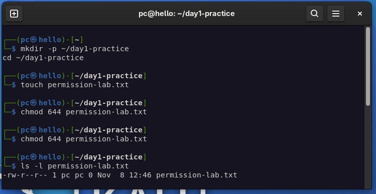
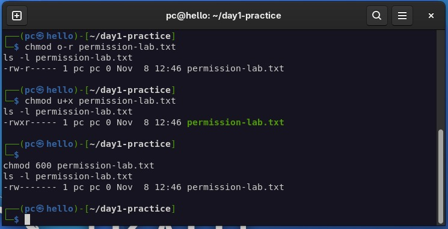
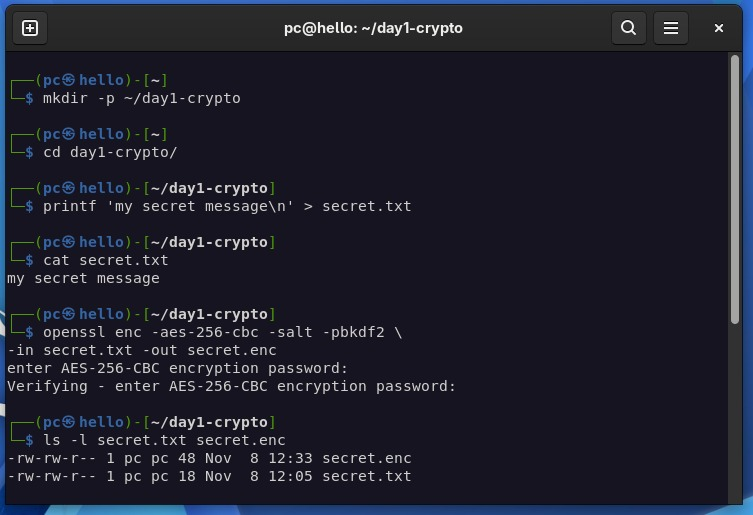
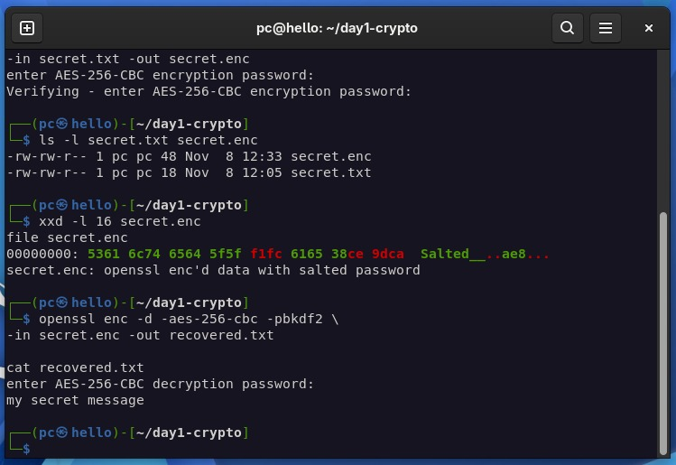

# DFCS Bootcamp - Assignment 1: S01 Foundations

| | |
|---|---|
| **Student** | `Uzair Arif` |
| **Cohort** | `<<ADD YOUR COHORT>>` |
| **Programme** | Digital Forensics & Cyber Security (DFCS) - Atomcamp |
| **Tasks** | A (compulsory) · B2 (Linux permissions) · B4 (OpenSSL and `Salted__`) |
| **Environment** | Kali Linux VM (VirtualBox NAT) · OpenSSL 3.x · terminal user `pc@hello` |
| **Evidence captured** | 8 November 2026, own Kali VM |

**Contents:** [Task A: Malware types](#task-a-malware-types-and-real-world-examples) · [SME analysis](#which-type-is-most-dangerous-for-a-pakistani-sme) · [Task B2: Permissions](#task-b2-linux-file-permissions) · [Task B4: OpenSSL](#task-b4-openssl-encryption-and-the-salted__-header) · [Security vocabulary](#security-vocabulary-handout-section-10) · [References](#references)

---

# Task A: Malware types and real-world examples

## The table

| Type | Definition in my own words | Named example + year | How it spread | Primary impact |
|---|---|---|---|---|
| **Virus** | Code that attaches itself to a host file or program and spreads only when that host is copied or run; it cannot travel on its own. | **CIH / Chernobyl (1998)** | Infected Windows 9x executable files and travelled on shared software, floppies and downloads; targeted home and office PCs running Windows 9x. [1] | Activated on 26 April each year: overwrote hard-disk data and on many machines flashed over the BIOS firmware itself, leaving the PC unbootable. |
| **Worm** | A complete program that copies itself across networks by itself, with no host file and no user click needed once it lands. | **Conficker (2008)** | Exploited the Windows SMB flaw MS08-067 and guessed weak passwords across network shares; targeted Windows machines in corporate and government estates, reaching millions of hosts. [2] | Built one of the largest botnets of its era and actively resisted removal by disabling Windows update and security services. |
| **Trojan** | Malware disguised as legitimate or useful software so the victim performs the installation themselves; the deception is the delivery mechanism. | **Zeus (2007)** | Delivered by phishing emails and drive-by downloads; targeted banking customers and businesses worldwide. [3] | Stole banking credentials and financial information on a massive scale; its source code leak powered successor botnets (Gameover Zeus) for years afterwards. |
| **Ransomware** | Encrypts the victim's files, increasingly after stealing a copy first, and sells access back; an availability attack with a business model. | **WannaCry (2017)** | Self-spreading over Windows SMB using the leaked EternalBlue exploit, no click required; targeted organisations running unpatched Windows, most famously the NHS in the UK. [4] | Around 19,000 NHS appointments and operations cancelled; 200,000+ machines in 150 countries hit within days. |
| **Spyware** | Sits silently on a device and harvests what it finds: messages, calls, location, microphone and camera. | **Pegasus (2016)** | Installed through malicious links and later fully zero-click exploits; targeted journalists, activists, lawyers and heads of state worldwide. [5] | Proved that even a fully patched phone can be owned by a well-funded attacker and triggered the ongoing global commercial-spyware scandal. |
| **Adware** | Software whose real job is showing ads and redirecting traffic; annoying at best, and dangerous because it already controls the browser. | **Fireball (2017)** | Bundled inside freeware installers; targeted consumers installing free software, hijacking roughly 250 million browsers. [6] | Hijacked homepages and search engines at global scale and could be switched from ad-fraud to payload-dropping on command. |
| **Rootkit** | Hides itself and whatever it carries below the level users and most antivirus tools inspect, so the machine reports itself clean. | **Sony BMG XCP (2005)** | Distributed silently on commercial music CDs; targeted customers who played the discs on Windows PCs. [7] | Hid its DRM files from the user and from antivirus, exposed every infected customer to follow-on malware, and became the textbook supply-chain scandal. |
| **Keylogger** | Records every keystroke typed on a device; the quiet way to turn one phishing click into every password the victim owns. | **HawkEye (2013)** | Sold as ready-made crimeware and delivered through phishing attachments and downloads; targeted individuals and small businesses. [8] | Captured passwords and sensitive information and fed credential-theft campaigns for years. |
| **Botnet agent** | A sleeper program left on thousands of machines so one operator can command them all at once, usually for DDoS or spam. | **Mirai (2016)** | Scanned the internet for cameras, DVRs and routers still using factory default passwords and logged in with `admin`-style credential pairs; targeted IoT devices. [9] | Recruited ~600,000 devices; its 1.1 Tbps DDoS against DNS provider Dyn knocked Twitter, Netflix, Reddit and more offline across the US. |
| **Fileless / living-off-the-land** | An attack that never writes malware to disk: it runs in memory and abuses trusted admin tools (PowerShell, WMI) already present on the machine. | **Astaroth (2018)** | Phishing with `.lnk` shortcuts that used legitimate Windows tools (`WMIC`, `regsvr32`) to fetch and assemble the payload entirely in memory; targeted users and organisations in Brazil and Latin America. [10] | Stole credentials and banking data while leaving almost nothing for file-scanning antivirus to find, forcing detection to move to behaviour. |
| **Logic bomb** | Malicious code that stays dormant until a trigger condition, then detonates; insiders plant it because they already have access. | **Omega Engineering incident (1996)** | Did not spread at all: a disgruntled insider planted destructive code on his employer's systems. [11] | Deleted design and production programs, causing millions of dollars of damage and a landmark federal prosecution. |
| **Bootkit** | A rootkit that infects the boot chain itself (MBR or UEFI) so it loads before the OS, survives reinstalls, and controls what the OS sees. | **TDL-4 (2011)** | Infected the Master Boot Record before Windows loaded and recruited ~4.5 million Windows machines into a peer-to-peer botnet. [12] | Earned the label "indestructible": reformatting the disk did not remove it, and it hid its own traffic from detection. |

## Which type is most dangerous for a Pakistani SME?

Ransomware is particularly dangerous for Pakistani small and medium-sized businesses because it can make accounting records, customer databases and operational files inaccessible. Many SMEs may not have reliable offline backups or a dedicated incident response team, making recovery expensive and time-consuming. Regular offline backups, security updates, MFA and employee phishing awareness are important preventive controls.

---

# Task B2: Linux file permissions

## Objective

Create a file, change its permissions three ways with `chmod` (symbolic and octal), and explain what each change did, showing `ls -l` before and after each change with the octal value labelled.

## The commands (run in my Kali VM)

```bash
mkdir -p ~/day1-practice
cd ~/day1-practice
touch permission-lab.txt

chmod 644 permission-lab.txt      # octal: set the baseline
ls -l permission-lab.txt

chmod o-r permission-lab.txt      # symbolic: remove read from others
ls -l permission-lab.txt

chmod u+x permission-lab.txt      # symbolic: add execute for the owner
ls -l permission-lab.txt

chmod 600 permission-lab.txt      # octal: owner-only
ls -l permission-lab.txt
```

## Actual results (my terminal)

| Stage | Command | Notation | Resulting mode | Octal | What the change did |
|---|---|---|---|---|---|
| 1. Baseline | `chmod 644` | octal | `rw-r--r--` | **644** | Set the normal file mode: owner read/write, group read, others read. |
| 2. Remove others' read | `chmod o-r` | symbolic | `rw-r-----` | **640** | Removed read from `others` only; owner and group bits untouched. Other users on a shared system can no longer open the file. |
| 3. Add owner's execute | `chmod u+x` | symbolic | `rwxr-----` | **740** | Added execute for the owner only, making the file runnable as a program without widening access for anyone else. |
| 4. Owner only | `chmod 600` | octal | `rw-------` | **600** | Reset the whole mode to owner read/write; the correct mode for private files such as keys. |

```text
$ ls -l permission-lab.txt
-rw-r--r-- 1 pc pc 0 Nov  8 12:46 permission-lab.txt
$ chmod 644 permission-lab.txt
$ ls -l permission-lab.txt
-rw-r--r-- 1 pc pc 0 Nov  8 12:46 permission-lab.txt
$ chmod o-r permission-lab.txt
$ ls -l permission-lab.txt
-rw-r----- 1 pc pc 0 Nov  8 12:46 permission-lab.txt
$ chmod u+x permission-lab.txt
$ ls -l permission-lab.txt
-rwxr----- 1 pc pc 0 Nov  8 12:46 permission-lab.txt
$ chmod 600 permission-lab.txt
$ ls -l permission-lab.txt
-rw------- 1 pc pc 0 Nov  8 12:46 permission-lab.txt
```

The baseline stage sets the normal file mode; the visible changes come from the two symbolic commands and the final octal reset.





## How the notation works

- Symbolic form is `who` + `action` + `what`: `u` owner, `g` group, `o` others, `a` all; `+` add, `-` remove, `=` set exactly; `r` read, `w` write, `x` execute.
- Octal form writes the same three bits per audience as a decimal digit: `r=4`, `w=2`, `x=1`, added together, one digit each for owner, group and others.
- Reading the results back: `640` means owner `rw` (4+2), group `r` (4), others nothing (0). `740` adds the owner's `x` (1) to the first digit.

**Conclusion.** Permissions control who can read, modify or execute a file. Each change narrowed or shifted access without ever touching the file's contents, which is why `chmod` is a configuration change, not a data change.

---

# Task B4: OpenSSL encryption and the Salted__ header

## Objective

Encrypt a file with OpenSSL, decode its header with `xxd`, and explain what `Salted__` means.

## The commands (run in my Kali VM)

```bash
mkdir -p ~/day1-crypto && cd ~/day1-crypto
printf 'my secret message\n' > secret.txt
cat secret.txt

openssl enc -aes-256-cbc -salt -pbkdf2 -in secret.txt -out secret.enc
ls -l secret.txt secret.enc

xxd -l 16 secret.enc
file secret.enc

openssl enc -d -aes-256-cbc -pbkdf2 -in secret.enc -out recovered.txt
cat recovered.txt
```

## Actual output (my terminal)

```text
$ cat secret.txt
my secret message
$ openssl enc -aes-256-cbc -salt -pbkdf2 -in secret.txt -out secret.enc
enter AES-256-CBC encryption password:
Verifying - enter AES-256-CBC encryption password:
$ ls -l secret.txt secret.enc
-rw-rw-r-- 1 pc pc 18 Nov  8 12:05 secret.txt
-rw-rw-r-- 1 pc pc 48 Nov  8 12:33 secret.enc
$ xxd -l 16 secret.enc
00000000: 5361 6c74 6564 5f5f f1fc 6165 38ce 9dca
$ file secret.enc
secret.enc: openssl enc'd data with salted password
$ openssl enc -d -aes-256-cbc -pbkdf2 -in secret.enc -out recovered.txt
enter AES-256-CBC encryption password:
$ cat recovered.txt
my secret message
```





## Decoding the header

The first 16 bytes break down as:

| Bytes (hex) | ASCII | Meaning |
|---|---|---|
| `53 61 6c 74 65 64 5f 5f` | `Salted__` | OpenSSL's 8-byte magic header, written whenever `-salt` is used |
| `f1 fc 61 65 38 ce 9d ca` | *(random)* | The actual random salt generated for this encryption |

The file sizes confirm the structure: `secret.txt` is 18 bytes (17 characters plus the newline `printf` added), and `secret.enc` is 48 bytes: 8 bytes of `Salted__` magic + 8 bytes of salt + 32 bytes of ciphertext (the 18-byte plaintext padded up to the next 16-byte AES block boundary).

## What `Salted__` means

`Salted__` is an 8-byte ASCII magic header that OpenSSL writes at the start of the output whenever the `-salt` flag is used; the 8 bytes that follow are the random salt itself. The salt is mixed into the password-based key derivation (`-pbkdf2`), so encrypting the same file with the same password produces completely different ciphertext every time, which defeats precomputed password-to-key tables. The header is not the password and not the key, and it is not secret: it is metadata that tells the decryption step which salt to use when re-deriving the key. In forensics this is exactly why `file` can identify an unknown blob as "openssl enc'd data with salted password" in seconds; the signature identifies the tool, not the content.

---

# Security vocabulary (handout section 10)

| Term | Definition in my own words |
|---|---|
| **Asset** | Something valuable that needs protection, such as a server, database or customer information. |
| **Threat** | A person, event or situation that could cause harm to an asset. |
| **Vulnerability** | A weakness in a system that a threat can exploit. |
| **Risk** | The combination of the likelihood of an incident and its potential impact. |
| **Exploit** | A method, code or technique used to take advantage of a vulnerability. |

---

# References

1. F-Secure Labs, "CIH" (virus description). https://www.f-secure.com/v-descs/cih.shtml
2. CISA (US-CERT) Alert TA09-088A, "Conficker Worm" (2009). https://www.cisa.gov/news-events/alerts/2009/TA09-088A
3. U.S. Department of Justice, charges announced against the operators of the Gameover Zeus botnet (June 2014). https://www.justice.gov/opa
4. National Audit Office (UK), "Investigation: WannaCry cyber attack and the NHS" (2018). https://www.nao.org.uk/reports/investigation-wannacry-cyber-attack-and-the-nhs/
5. Citizen Lab, "Hide and Seek: Tracking NSO Group's Pegasus Spyware to Operations in 45 Countries" (2018). https://citizenlab.ca/2018/09/hide-and-seek-tracking-nso-groups-pegasus-spyware-to-operations-in-45-countries/
6. Check Point Research, "Fireball: Chinese-Ad-Packaged Malware Threatens 250 Million Victims" (2017). https://blog.checkpoint.com/research/fireball-chinese-ad-packaged-malware-threatens-250-million-victims/
7. Russinovich, M., "Sony, Rootkits and Digital Rights Management Gone Too Far" (Sysinternals blog, 31 October 2005).
8. Trend Micro Research, HawkEye keylogger analyses. https://www.trendmicro.com/en_us/research.html
9. Cloudflare Learning Center, "What is the Mirai botnet?". https://www.cloudflare.com/learning/ddos/glossary/mirai-botnet/
10. Microsoft Security Blog, "Dismantling the fileless, living-off-the-land Astaroth attack through behavior monitoring" (2019). https://www.microsoft.com/en-us/security/blog/2019/07/08/dismantling-the-fileless-living-off-the-land-astaroth-attack-through-behavior-monitoring/
11. United States v. Lloyd, 269 F.3d 228 (3d Cir. 2001) - the Omega Engineering logic bomb prosecution.
12. Kaspersky Securelist, "The 'Indestructible' TDL-4 Botnet" (2011). https://securelist.com/the-tdl-4-botnet-33922/
