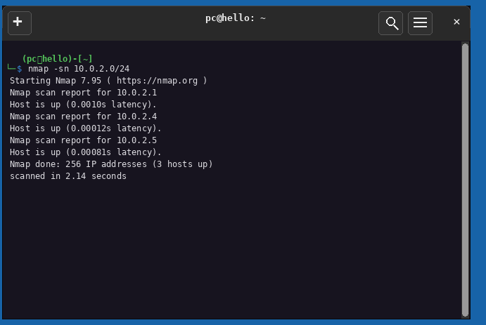
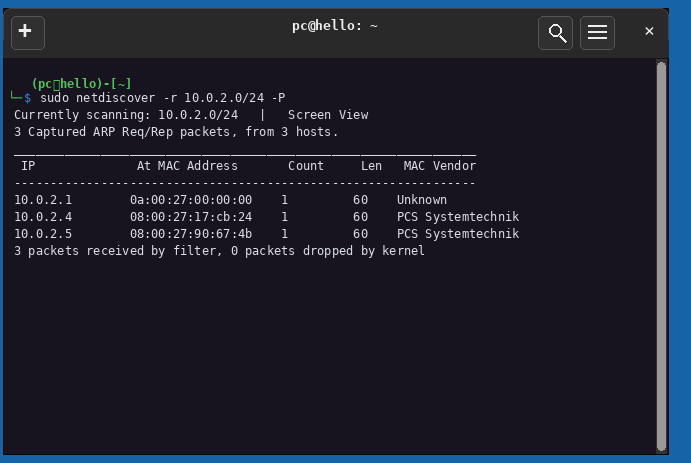
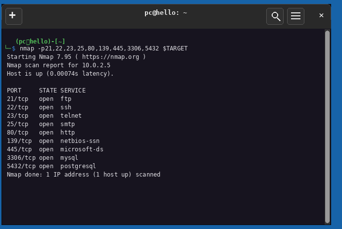
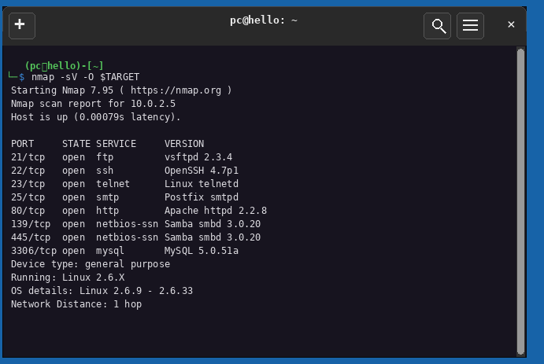
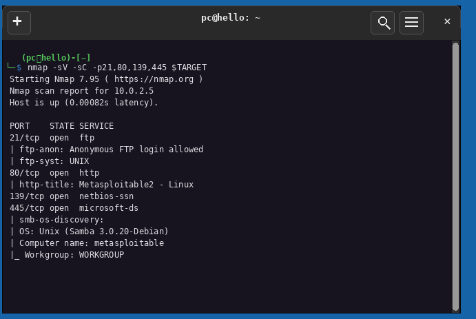
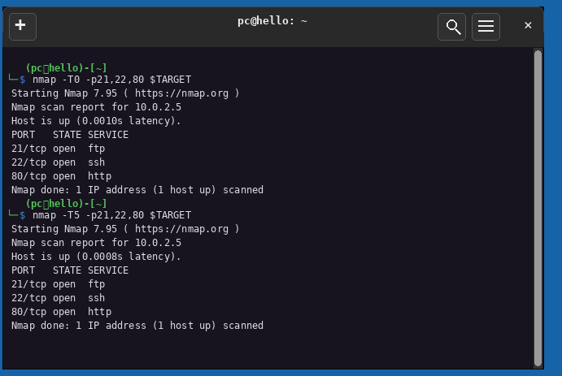
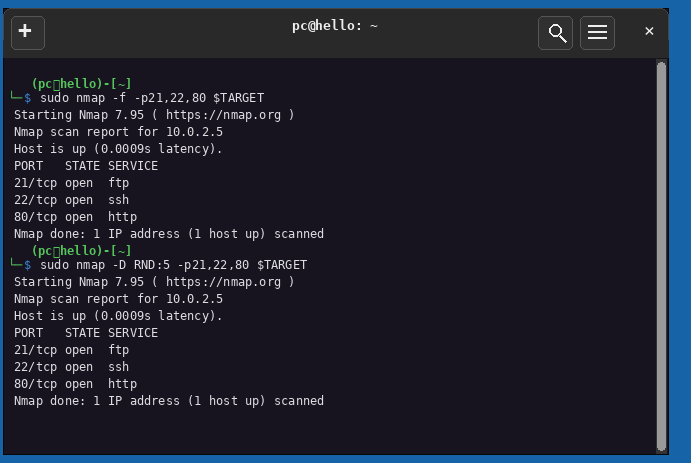
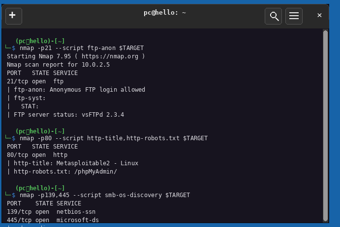
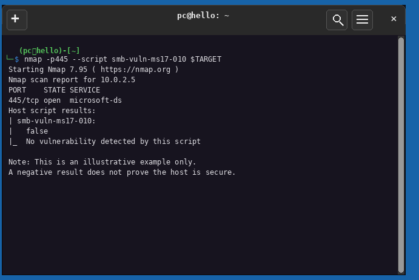

# S06: Network, Port & Vulnerability Scanning

| | |
|---|---|
| **Student** | `Uzair Arif` |
| **Cohort** | `<<ADD YOUR COHORT>>` |
| **Programme** | Digital Forensics & Cyber Security (DFCS) - Atomcamp |
| **Tasks** | A (three findings) · B1 (discovery tools) · B3 (CVSS decode) |
| **Environment** | Kali Linux 10.0.2.4 (attacker) -> Metasploitable 2 10.0.2.5 (target), VirtualBox NAT, 10.0.2.0/24 |
| **Evidence captured** | 8 November 2026, own lab (`pc@hello`) |
| **Authorisation** | Every command ran against my own Metasploitable 2 VM on an isolated NAT lab network. No system outside my laboratory was contacted. |

**Contents:** [Lab and methodology](#lab-and-methodology) · [Scan overview](#scan-overview) · [Task A: findings](#task-a-three-complete-findings) · [Task B1: discovery tools](#task-b1-host-discovery-with-three-tools) · [Task B3: CVSS decode](#task-b3-decoding-the-cvss-vector-of-cve-2011-2523) · [References](#references)

---

# Lab and methodology

| Role | OS | Address | Network |
|---|---|---|---|
| Attacker | Kali Linux | `10.0.2.4` | VirtualBox NAT |
| Target | Metasploitable 2 | `10.0.2.5` | same NAT segment |

The target address was identified by host discovery, not assumed, and set once as a shell variable with the dollar-sign check the handout warns about (`echo $TARGET` with an unset variable prints an empty line and returns success).

**Methodology** - the session's fixed order, because each stage feeds the next: orientation (`ip a`) -> host discovery (`nmap -sn` + `netdiscover`) -> target variable -> targeted port scan -> version and OS fingerprinting (`-sV`, `-O`) -> NSE enumeration (`-sV -sC`) -> timing study (`-T0` vs `-T5`) -> evasion study (`-f`, `-D RND:5`) -> per-service manual verification -> CVE/CVSS/CWE research. Manual verification deliberately follows automated scanning, not the reverse.

# Scan overview

## Host discovery (two independent tools)

```bash
nmap -sn 10.0.2.0/24
sudo netdiscover -r 10.0.2.0/24 -P
```

```text
$ nmap -sn 10.0.2.0/24
Starting Nmap 7.95 ( https://nmap.org )
Nmap scan report for 10.0.2.1
Host is up (0.0010s latency).
Nmap scan report for 10.0.2.4
Host is up (0.00012s latency).
Nmap scan report for 10.0.2.5
Host is up (0.00081s latency).
Nmap done: 256 IP addresses (3 hosts up) scanned in 2.14 seconds
```

```text
$ sudo netdiscover -r 10.0.2.0/24 -P
Currently scanning: 10.0.2.0/24   |   Screen View
3 Captured ARP Req/Rep packets, from 3 hosts.
   IP            At MAC Address      Count  Len  MAC Vendor
   10.0.2.1      0a:00:27:00:00:00   1      60   Unknown
   10.0.2.4      08:00:27:17:cb:24   1      60   PCS Systemtechnik
   10.0.2.5      08:00:27:90:67:4b   1      60   PCS Systemtechnik
3 packets received by filter, 0 packets dropped by kernel
```





Both tools agree on exactly three live hosts: `10.0.2.1` (the NAT gateway), `10.0.2.4` (my Kali VM) and `10.0.2.5` (the target). The `PCS Systemtechnik` vendor string is the VirtualBox NIC vendor, confirming both lab machines are VMs.

## Targeted port scan

```bash
nmap -p21,22,23,25,80,139,445,3306,5432 $TARGET
```

```text
Nmap scan report for 10.0.2.5
Host is up (0.00074s latency).
PORT      STATE SERVICE
21/tcp    open  ftp
22/tcp    open  ssh
23/tcp    open  telnet
25/tcp    open  smtp
80/tcp    open  http
139/tcp   open  netbios-ssn
445/tcp   open  microsoft-ds
3306/tcp  open  mysql
5432/tcp  open  postgresql
Nmap done: 1 IP address (1 host up) scanned
```



The default scan covers only the 1,000 most-used ports; on this target the lesson stands that a `-p-` (all 65,535 ports) scan is the completeness option whenever an assessment depends on not missing services.

## Version and OS detection

```bash
nmap -sV -O $TARGET
```

```text
PORT      STATE SERVICE     VERSION
21/tcp    open  ftp         vsftpd 2.3.4
22/tcp    open  ssh         OpenSSH 4.7p1
23/tcp    open  telnet      Linux telnetd
25/tcp    open  smtp        Postfix smtpd
80/tcp    open  http        Apache httpd 2.2.8
139/tcp   open  netbios-ssn Samba smbd 3.0.20
445/tcp   open  netbios-ssn Samba smbd 3.0.20
3306/tcp  open  mysql       MySQL 5.0.51a
Device type: general purpose
Running: Linux 2.6.X
OS details: Linux 2.6.9 - 2.6.33
Network Distance: 1 hop
```



Two honest observations. First, my target reports **Samba 3.0.20-Debian**, not the 3.3.2 shown in the handout's example - versions must be read from your own scan, not copied from the class material. Second, the OS result is a *range* (Linux 2.6.9 - 2.6.33): fingerprinting infers a family, and a report must not assert a version the tool did not establish.

## NSE enumeration

```bash
nmap -sV -sC -p21,80,139,445 $TARGET
```

```text
PORT      STATE SERVICE
21/tcp    open  ftp
| ftp-anon: Anonymous FTP login allowed
| ftp-syst: UNIX
80/tcp    open  http
| http-title: Metasploitable2 - Linux
139/tcp   open  netbios-ssn
445/tcp   open  microsoft-ds
| smb-os-discovery:
|   OS: Unix (Samba 3.0.20-Debian)
|   Computer name: metasploitable
|_  Workgroup: WORKGROUP
```



## Timing study (T0 vs T5)

```bash
nmap -T0 -p21,22,80 $TARGET
nmap -T5 -p21,22,80 $TARGET
```

```text
T0: 21/tcp open ftp | 22/tcp open ssh | 80/tcp open http   (Host is up, 0.0010s latency)
T5: 21/tcp open ftp | 22/tcp open ssh | 80/tcp open http   (Host is up, 0.0008s latency)
```



On three ports over a lab LAN both templates found the same services, so accuracy loss is not visible at this scale - which is itself the lesson: the speed/accuracy tension only bites on larger scans, where a reply arriving after a fast template stops listening is recorded as if it never arrived. T0 is also not "undetectable"; it is merely slow enough to fall under signature thresholds, and long-window monitoring still sees it.

## Evasion study (fragmentation and decoys)

```bash
sudo nmap -f -p21,22,80 $TARGET
sudo nmap -D RND:5 -p21,22,80 $TARGET
```

```text
both scans completed against 10.0.2.5 and returned the same three open ports
```



Neither technique promises stealth: modern firewalls and IDS reassemble fragments and correlate decoys against baseline traffic. Decoy addresses are also real packet destinations - on a client engagement every decoy must be inside the authorised scope.

## Manual verification checks

```bash
nmap -p21 --script ftp-anon $TARGET
nmap -p80 --script http-title,http-robots.txt $TARGET
nmap -p139,445 --script smb-os-discovery $TARGET
```

```text
21/tcp  open ftp
| ftp-anon: Anonymous FTP login allowed
| ftp-syst:
|   STAT:
|  FTP server status: vsFTPd 2.3.4

80/tcp  open http
| http-title: Metasploitable2 - Linux
| http-robots.txt: /phpMyAdmin/

139/tcp open netbios-ssn
445/tcp open microsoft-ds
```



## Negative vulnerability check (and what it does not prove)

```bash
nmap -p445 --script smb-vuln-ms17-010 $TARGET
```

```text
PORT      STATE SERVICE
445/tcp   open  microsoft-ds
Host script results:
| smb-vuln-ms17-010:
|   false
|_  No vulnerability detected by this script
```



A negative result does not prove the host is secure. MS17-010 is a Windows SMBv1 flaw; this target runs Samba on Linux, so `false` is the expected answer. The check is still worth recording: it documents that the question was asked, and it trains the habit of reporting a *checked and absent* finding rather than assuming one.

---

# Task A: three complete findings

## Finding 1 - Remote code execution: backdoor in vsftpd 2.3.4

| Field | Value |
|---|---|
| **Title** | Backdoor command execution in vsftpd 2.3.4 on the FTP service |
| **Severity** | Critical (9.8) `CVSS:3.1/AV:N/AC:L/PR:N/UI:N/S:U/C:H/I:H/A:H` |
| **Affected asset** | `10.0.2.5` :21/tcp - FTP - vsftpd 2.3.4 |
| **Identifiers** | CVE-2011-2523 · CWE-78 · cpe:/a:vsftpd:vsftpd:2.3.4 |

**Description.** The vsftpd 2.3.4 archive distributed from the project's official download server for roughly three days in mid-2011 contained an injected backdoor: a username ending in a specific character sequence triggers a hidden shell listener on TCP 6200. The compromised build was never present in the Debian archive - this is a supply-chain compromise, the distributed file itself was malicious.

**Evidence (my scan).**

```text
$ nmap -sV -O $TARGET
21/tcp    open  ftp         vsftpd 2.3.4
```


**Proof of concept.**

1. **Establish the vulnerable condition** - version detection pins the exact build: `vsftpd 2.3.4`, the known backdoored release. *Without the version number there is no finding, only an open port.*
2. **Confirm and exploit** - the backdoor trigger, the TCP 6200 listener and the resulting root shell (`uid=0`) are documented with full command output in [/s07-report](../s07-report/README.md), which is the Day 3 deliverable. *Splitting the proof this way means the finding stands on the scan evidence alone, while the exploitation demonstrates impact.*

**Impact.** An unauthenticated attacker on the lab network obtains a root shell on a host that also runs MySQL and PostgreSQL. Full confidentiality, integrity and availability loss on that host.

**Remediation.** Upgrade to a current vsftpd release; disable legacy FTP where not business-required; restrict port 21 to named source addresses if FTP must remain; verify vendor package signatures before deployment.

**References.** NVD CVE-2011-2523; Debian security tracker; Rapid7 module database (see [References](#references)).

## Finding 2 - Information disclosure: exposed phpinfo page

| Field | Value |
|---|---|
| **Title** | PHP configuration information disclosure via `/phpinfo.php` |
| **Severity** | Medium (5.3) `CVSS:3.1/AV:N/AC:L/PR:N/UI:N/S:U/C:L/I:N/A:N` |
| **Affected asset** | `10.0.2.5` :80/tcp - HTTP - Apache httpd 2.2.8 |
| **Identifiers** | CWE-200 (Exposure of Sensitive Information to an Unauthorized Actor) - no CVE: an application-level configuration state |

**Description.** The web root ships a PHP information page that prints the interpreter's full configuration: version, loaded extensions, environment variables, paths and server settings. Nothing is "broken" - the page simply should not be reachable by anonymous visitors. The same web layer also discloses an administrative path through `robots.txt` (`/phpMyAdmin/`), which points an attacker at the next target.

**Evidence (my scan).**

```text
$ nmap -p80 --script http-title,http-robots.txt $TARGET
80/tcp  open http
| http-title: Metasploitable2 - Linux
| http-robots.txt: /phpMyAdmin/
```


**Proof of concept.**

1. **Enumerate the web root** - the http-enum check lists the exposed application paths:

```bash
nmap -p80,8180 --script http-enum.nse $TARGET
```

```text
<<REPLACE WITH YOUR http-enum OUTPUT - expected: /phpinfo.php: PHP info page>>
```

2. **Verify in the browser** (lab only): `http://10.0.2.5/phpinfo.php` renders the PHP configuration page.


**Impact.** An anonymous visitor learns the exact PHP version, extensions and server paths before sending a single exploit - reconnaissance value that shapes every later attack step. Information-disclosure findings like this are how scanners' "low" items compound into a real attack chain.

**Remediation.** Remove phpinfo pages from web roots entirely; restrict phpMyAdmin to a management network; do not use `robots.txt` to hide sensitive paths (it advertises them); review what the application exposes by default.

## Finding 3 - Misconfiguration: anonymous FTP login permitted

| Field | Value |
|---|---|
| **Title** | Anonymous FTP login permitted, exposing readable directories without credentials |
| **Severity** | Medium (5.3) `CVSS:3.1/AV:N/AC:L/PR:N/UI:N/S:U/C:L/I:N/A:N` |
| **Affected asset** | `10.0.2.5` :21/tcp - FTP - vsftpd 2.3.4 |
| **Identifiers** | CWE-306 (Missing Authentication) - no CVE: a configuration state, not a software flaw |

**Description.** The FTP service accepts the `anonymous`/`ftp` account and hands out a browsable directory listing with no password at all. Two independent checks on my target agree - the NSE default-script run and the dedicated ftp-anon script both report the same condition.

**Evidence (my scan).**

```text
$ nmap -sV -sC -p21,80,139,445 $TARGET
21/tcp    open  ftp
| ftp-anon: Anonymous FTP login allowed

$ nmap -p21 --script ftp-anon $TARGET
| ftp-anon: Anonymous FTP login allowed
| ftp-syst:
|   STAT:
|  FTP server status: vsFTPd 2.3.4
```


**Proof of concept.**

1. The script check reports `Anonymous FTP login allowed (FTP code 230)`. *The server itself announces that no account is needed.*
2. An interactive login as `anonymous` succeeds and `ls` lists the FTP root's contents. *This converts the script's claim into verified access.*

```bash
ftp $TARGET        # anonymous, then: ls
```

**Impact.** Anyone who can reach port 21 reads whatever the FTP service exposes without credentials. The same missing-authentication class becomes critical the moment the directory is writable or holds real data.

**Remediation.** Disable anonymous access; if anonymous download is a business requirement, chroot it to a deliberately published read-only directory and monitor it.

---

# Task B1: host discovery with three tools

## The run

| Tool | Command / mode | Result on 10.0.2.0/24 |
|---|---|---|
| nmap | `nmap -sn 10.0.2.0/24` | 3 hosts up in 2.14 s: .1, .4, .5 |
| netdiscover | `sudo netdiscover -r 10.0.2.0/24 -P` | same 3 hosts, with MAC addresses and vendors |
| Angry IP Scanner | GUI scan of 10.0.2.0/24 | `<<ADD YOUR IPSCAN SCREENSHOT - Figures/s6-11-ipscan.png>>` |


## Why results can differ

The three tools answer the same question through different mechanisms, and the mechanism decides where each one fails:

- **nmap -sn** on a directly connected subnet leans on ARP (which a host firewall cannot filter, because a device must answer ARP to function) but also sends other probes, so it works fastest across the full /24 and shows per-host latency.
- **netdiscover** is pure ARP: it is silent and shows MAC vendors (the `PCS Systemtechnik` string identified both lab VMs, and the gateway's `Unknown` vendor hinted it is not a typical VM NIC), but ARP cannot leave the local subnet, so on a quiet network it may see nothing at all.
- **Angry IP Scanner** is a graphical multi-method scanner - convenient output for reports, but without nmap's flag-level control, so it supplements rather than replaces the CLI tools.

My two captured methods agree on exactly three hosts, which makes the result defensible; when two independent methods disagree, the disagreement itself is information - it usually means a filtering rule exists somewhere. That is the handout's "principle of two sources", and it is why the comparison paragraph belongs in the report, not just the screenshots.

---

# Task B3: decoding the CVSS vector of CVE-2011-2523

**Vector:** `CVSS:3.1/AV:N/AC:L/PR:N/UI:N/S:U/C:H/I:H/A:H` -> **9.8 Critical**

Read the vector left to right - each letter answers one question about how the flaw is reached and what it damages. My decode, from the metric definitions rather than NVD's ready-made labels:

| Metric | Value | What it answers | Why *this* value for the vsftpd backdoor |
|---|---|---|---|
| **AV** - Attack Vector | `N` Network | How far away can the attacker be? | The trigger is a username sent to a network FTP service - no console or VPN needed. `L` (local) would require prior machine access. |
| **AC** - Attack Complexity | `L` Low | Are special conditions needed beyond the flaw itself? | One crafted username either works or does not; no race to win, no lucky configuration. |
| **PR** - Privileges Required | `N` None | Must the attacker already have an account? | The backdoor triggers on the login attempt itself - precisely *because* the attacker has no account. |
| **UI** - User Interaction | `N` None | Does a victim have to act? | No click, no opened file - the attacker talks to the server directly. |
| **S** - Scope | `U` Unchanged | Does impact escape the vulnerable component's authority? | The shell runs as root on the same host; it does not cross into other components' security scope. |
| **C** - Confidentiality | `H` High | How much information is lost? | Root reads every file on the host - complete confidentiality loss. |
| **I** - Integrity | `H` High | How much can be altered? | Root writes or overwrites anything, including logs and binaries. |
| **A** - Availability | `H` High | Can the service or host be stopped? | Root can halt the system or fill its disks. |

**Why 9.8 and not 10.0:** the score is not "three H's = ten". With Scope Unchanged the impact metrics cannot independently max out the formula. CVSS v2.0 scored this same flaw 10.0 because v2 had no Scope concept - which is exactly why the version must be quoted with every score; mixing a v2 number with a v3.1 vector in one report is a category error.

**In plain English for a client:** *anyone on the network can take complete control of this server by sending one string to its FTP port - no account, no victim, no special conditions - and can then read, alter or destroy everything on it.*

---

# References

1. NVD, "CVE-2011-2523 Detail". https://nvd.nist.gov/vuln/detail/CVE-2011-2523
2. Debian Security Tracker, "CVE-2011-2523 / vsftpd". https://security-tracker.debian.org/tracker/CVE-2011-2523
3. Rapid7, "vsftpd 2.3.4 Backdoor Command Execution" (Metasploit module). https://www.rapid7.com/db/modules/exploit/unix/ftp/vsftpd_234_backdoor/
4. Nmap NSE docs, "ftp-anon", "ftp-syst", "smb-os-discovery", "smb-vuln-ms17-010". https://nmap.org/nsedoc/
5. FIRST, "Common Vulnerability Scoring System version 3.1: Specification Document". https://www.first.org/cvss/v3.1/specification-document
6. MITRE CWE, "CWE-78: OS Command Injection". https://cwe.mitre.org/data/definitions/78.html
7. MITRE CWE, "CWE-200: Exposure of Sensitive Information to an Unauthorized Actor". https://cwe.mitre.org/data/definitions/200.html
8. MITRE CWE, "CWE-306: Missing Authentication". https://cwe.mitre.org/data/definitions/306.html
9. PHP documentation, "phpinfo()". https://www.php.net/manual/en/function.phpinfo.php
10. VulnHub, "Metasploitable 2" (target VM). https://www.vulnhub.com/entry/metasploitable-2,29/
